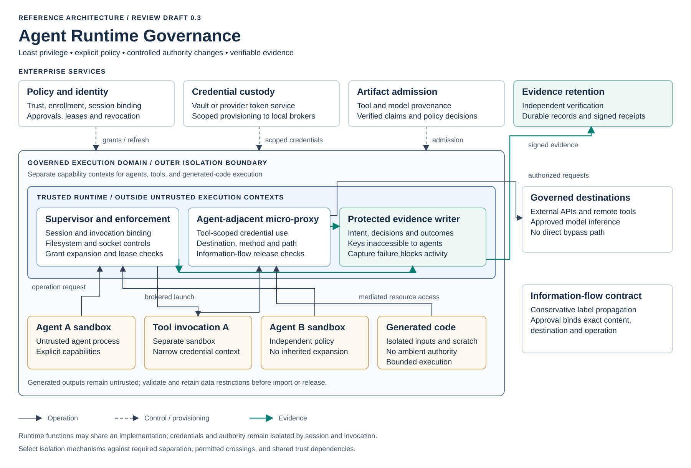
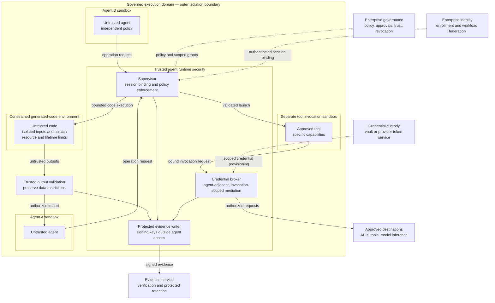
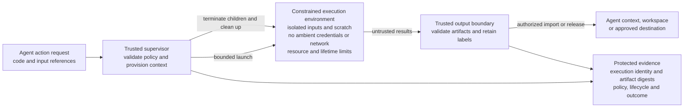
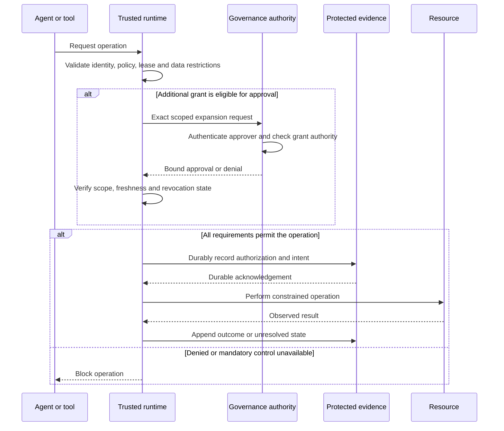
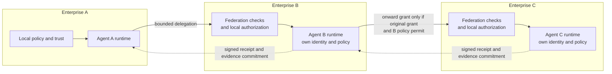
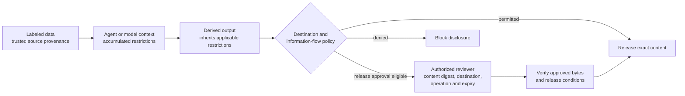

# Agent Runtime Governance: A Reference Architecture

**Technical paper · Review draft 0.3 · 14 October 2026**

**Luke Hinds · nolabs**

**Affiliation disclosure:** The author is affiliated with nolabs. The architecture specifies vendor-neutral security contracts. Draft preparation and research were assisted by OpenAI Codex. This review draft has not undergone independent technical review.

## Abstract

Agent runtime governance comprises the mechanisms that constrain agent actions, manage changes to their authority, and preserve attributable evidence throughout their lifecycle. Its scope includes resource access, code execution, tool invocation, communication, and delegated operations. Isolation, authorization, information-flow control, and evidence integrity impose distinct requirements that must be satisfied jointly.

This paper presents a reference architecture organized around explicit protection domains and mediated interactions. A trusted runtime control system enforces narrowly scoped capabilities, mediates credential use, authorizes runtime grant changes, and records observations outside the agent's control. Identity binds actions to principals and authorization chains. Provenance supports artifact admission and the propagation of data restrictions.

The architecture applies to developer devices, continuous integration runners, managed execution domains, and federated enterprise environments. The contribution is a composition of established security mechanisms, together with explicit trust assumptions, enforcement contracts, and failure semantics. Isolation mechanisms and deployment topologies remain implementation choices subject to those requirements. The paper specifies an architectural model; empirical validation and quantitative performance evaluation remain future work.

## Introduction and scope

Agent actions may be selected in response to retrieved content, external messages, model outputs, and generated code. The resulting behavior may change during a session, including the resources accessed and the authority requested. Authorization established at session admission must therefore remain enforceable at subsequent action boundaries.

An outer isolation boundary defines the separation between a governed execution domain, surrounding infrastructure, and other domains. Its specification identifies protected resources, shared trust dependencies, and permitted interactions. Within the domain, finer capability boundaries constrain the authority of individual agents and execution contexts. Isolation mechanisms are selected according to these separation requirements.

Authentication establishes principal identity; authorization determines permitted operations; evidence integrity supports verification of recorded observations. These properties are independent. A valid identity does not establish operation authority, and a valid signature does not establish policy compliance. The architecture requires their association at the relevant enforcement boundary.

Runtime governance requires enforcement of action scope, resource access, credential use, information release, and evidence obligations. These requirements apply during authority changes, communication failures, and execution of untrusted code. The enforcement model must specify both permitted behavior and the conditions under which further activity is denied.

The runtime control system must observe and mediate actions at the granularity required by policy. Enterprise governance functions establish policy, issuer trust, approval authority, and evidence-retention requirements. Their interfaces support local enforcement of validated policy, subject to explicit freshness, revocation, and durability constraints.

**Figure 1. Architecture overview.** Each agent, tool invocation, and generated-code execution has its own capability context. Trusted runtime functions may share an implementation but must preserve those contexts. The outer boundary represents required isolation properties, independent of the mechanisms used to implement them. The same governance contracts apply across devices, CI runners, and managed environments. [Standalone vector](diagrams/overview.svg) · [Print version](diagrams/overview.pdf)

## Architectural model and terminology

An **action** is an operation initiated by an agent that accesses or modifies a resource, executes code, communicates information, or requests a change in authority. An **execution context** is the state and capability scope under which an action or sequence of actions executes. A **governed execution domain** comprises contexts subject to a declared outer isolation boundary. A **grant** is an explicit authorization bounded by subject, resource, operation, validity, and applicable delegation conditions.

The action is the unit of authorization. Tool invocations and generated-code executions are specific action classes. A trusted enforcement component validates the applicable grants and policy, constrains the operation, and records the observations required by the evidence contract.

The architecture distinguishes isolation, runtime security, and enterprise governance. Isolation establishes separation between protection domains. Runtime security enforces resource-access and information-flow restrictions within and across those domains. Enterprise governance establishes policy, authorizes changes, manages trust, and retains evidence. Scheduling, planning, and resource placement are orchestration responsibilities subject to these security contracts.

Low enforcement overhead is a design objective. Validated policy may be evaluated locally without a synchronous control-plane request for each operation. Authorization leases, approval requirements, and evidence-buffer limits determine when external coordination is required. Performance claims require measurement under the specified enforcement configuration.

Diagram components denote logical functions and trust boundaries. Their physical placement and packaging are implementation decisions constrained by the required separation properties.

Within this reference model, “must” denotes an architectural requirement and “may” denotes an option permitted under the applicable policy. These terms specify the proposed contracts; they do not imply that an existing implementation has been evaluated against them.

## Trust model

Agents, their generated commands, tool inputs, retrieved content, and executable tools may be compromised. Agent behavior may also be incorrect without any adversary: model outputs are probabilistic, so an agent acting on legitimate instructions can select harmful or unintended actions. The architecture therefore treats agent behavior as untrusted regardless of cause. The trusted computing base includes the runtime supervisor, enforcement mechanisms, credential mediator, underlying isolation mechanisms and their supporting platform, and enterprise identity and governance services. Artifact approval and signature verification establish only the properties covered by their verification procedures; agent behavior remains untrusted.

The baseline security model assumes correct operation of the trusted computing base. A malicious infrastructure operator is outside this model. Extending the model to include that adversary requires additional mechanisms and assumptions, potentially including independent evidence witnesses and attested execution environments.

An execution domain may contain several independently governed agents. Each agent and action context retains its own policy and credential scope. Components shared by those contexts create shared trust dependencies; the architecture must identify which failures could affect multiple contexts. Shared writable files are explicit information channels and require policy and provenance handling. Workloads whose required separation cannot be established within one domain need distinct isolation domains.

The supervisor must be protected from the agent and from code the agent executes. Its placement relative to the outer boundary depends on the isolation design. The architecture requires protection of its memory, keys, configuration, control interfaces, and evidence; a process relationship or placement label is not sufficient evidence of that protection.

## Outer isolation boundary

The outer boundary contains an execution domain and defines its relationship to surrounding infrastructure and other domains. Its scope follows the required separation: ownership of data, administrative control, tolerated compromise, and permitted collaboration. An agent, a group of collaborating agents, or a constrained computation may occupy a domain; none of these implies a particular deployment unit.

The boundary specification comprises five elements:

1. **Protected assets:** execution state, data, credentials, control interfaces, and infrastructure whose access or modification is restricted across the boundary.
2. **Permitted interactions:** data ingress, artifact import, network and socket access, shared storage, control messages, and output release, each associated with an enforcement point and explicit policy.
3. **Compromise containment:** the application, runtime, kernel, or other component failures that the boundary is intended to contain, together with the trusted components whose compromise invalidates that guarantee.
4. **Interference bounds:** resource limits and isolation properties for execution, storage, and communication, including explicit side-channel exclusions.
5. **Lifecycle controls:** admission checks, configuration authority, teardown, state reuse, and failure behavior. Workloads must not be able to modify their own protection configuration.

Isolation mechanisms are selected against this specification. Process and operating-system sandboxes, container isolation, language or WebAssembly runtimes, virtual machines, microVMs, and dedicated hosts may contribute different properties in a composed design. These mechanisms have different trust dependencies and enforcement coverage. Selection is subject to the boundary specification rather than a prescribed stack. The implementation must demonstrate the required separation and identify its residual shared dependencies.

Outer isolation and inner capability enforcement form complementary parts of this design. The outer boundary establishes containment and permitted crossings between domains. Inner boundaries assign narrower authority to agents and action contexts within a domain. A permitted crossing at the outer boundary does not automatically authorize every context to use it, and an inner grant cannot bypass an outer restriction.

## Runtime governance topology

**Figure 2.** Solid arrows show requests and evidence; dashed arrows show control and provisioning. The shared runtime box represents trusted functions with isolated session and invocation contexts. It does not grant agents shared credentials. Direct paths from agents or tools to protected destinations must be prevented. Local filesystem and socket access are mediated by runtime and OS controls, independently of credential broker mediation.

The diagram expresses logical protection domains and mediated crossings. It does not prescribe a host layout or a deployment unit. Governance policy evaluates the isolation properties actually established in each environment.

## Explicit policy and least privilege

Authorization decisions must be derived deterministically from explicit policy and authenticated context. Policies refer to concrete resources and operations: executable identity, filesystem paths and access modes, sockets, credential references, destination identities, HTTP methods and paths, validity intervals, and optional consumption limits. Human-readable labels may organize rules but must not replace them with inferred intent.

Effective authority is the intersection of applicable enterprise policy, session grants, invocation policy, destination policy, and information-flow restrictions. Delegation constrains who may obtain authority, while the runtime enforces what an operation may do.

Tool identity must bind to the approved executable and its execution context. Executable identity cannot be established solely from a command name. Implementations must address executable replacement, interpreters, plugins, configuration, inherited file descriptors, environment variables, subprocesses, and time-of-check/time-of-use changes. A tool receives only the filesystem, network, socket, and credential permissions explicitly assigned to its invocation.

Paths require canonicalization and component-aware comparison at the enforcement boundary. Network controls require an explicit policy for name resolution, redirects, alternate transports, and connection reuse. If a required mediation mechanism is unavailable, the operation must be denied. A deployment using a different assurance profile requires explicit authorization and an accurate declaration of its enforcement coverage.

## Constrained execution environments

Agent-generated programs, scripts, queries, and notebooks require an independently authorized execution context. The trusted runtime establishes a constrained environment whose permissions are limited to the approved computation and input set. Approval of an interpreter or compiler does not extend to the behavior of submitted code.

This environment is a security primitive within runtime governance. Its boundary must protect the requesting agent, other execution contexts, and the trusted runtime from the submitted code. The design first specifies accessible inputs, permitted effects, shared trust dependencies, and termination behavior. An implementation is admitted only when its configured controls establish those properties. Where the generated code must be isolated from compromise of a shared enforcement component, its execution requires a separate protection domain.

The default environment is disposable and receives an explicit input set, an isolated writable scratch area, and a defined output channel. It does not inherit the agent's credentials, home directory, socket access, file descriptors, writable workspace mounts, or network authority. Live workspace access requires grants identifying precise paths and access modes. When concurrent modification is unnecessary, read-only snapshots or copies can bind execution to a fixed input set.

| Control | Execution contract |
| --- | --- |
| Code and runtime | Bind the execution request to the submitted artifact digest, approved interpreter or executable, arguments, and policy revision |
| Filesystem | Mount or copy only approved inputs; separate temporary writes from persistent workspace state |
| Credentials and sockets | Deny ambient access; mediate any explicitly authorized credential use or service socket |
| Network | Deny by default; allow only specifically approved destinations and operations through enforced mediation |
| Resources | Enforce CPU, memory, process-count, storage, output-size, and wall-time limits appropriate to the workload |
| Child execution | Keep subprocesses and spawned work within the execution context and its aggregate limits |
| Evidence | Record artifact and input references, effective policy, lifecycle, decisions, and observed outcome outside the generated code's control |
| Completion | Collect only permitted outputs, terminate remaining execution, revoke temporary grants, and clean up ephemeral state |

The execution boundary also applies to build and dependency-processing stages. Package installation, compiler extensions, build hooks, tests, and downloaded dependencies can execute code before the main program starts. Dependency acquisition requires its own constrained access path and provenance policy. Preparation stages are subject to the same explicit authorization requirements as the requested computation.

The runtime creates an execution identity linked to the requesting agent session and validates the code and input references before launch. Failure to establish the required sandbox configuration must deny execution. Additional access requires an explicit scoped approval through the runtime; submitted code cannot modify its own policy. Expiry, revocation, or mandatory audit failure must stop the relevant activity, including subprocesses. Resource-limit termination is recorded as a distinct outcome rather than being reported as successful completion.

Outputs remain untrusted data and inherit applicable information-flow restrictions. Successful execution does not authorize generated files to replace trusted configuration, enter another agent's executable search path, or be published externally. A trusted output boundary validates selected artifacts and applies destination policy before importing them into the workspace or releasing them. Collection must handle symlinks, path traversal, oversized output, and concurrent modification without reading outside the authorized output set. Content-bound approval applies where release requires declassification.

**Figure 3.** Generated-code execution is a governed action with an independent capability context. The supervisor observes execution from outside the environment; generated code is not the authoritative source of audit evidence. The output boundary does not certify that a computation is correct or benign.

## Credential broker

The credential broker is the runtime primitive that mediates credential use on behalf of an authorized action context. It operates adjacent to the agent while remaining outside the agent's accessible trust boundary. The broker retains upstream credentials and applies them only to authorized operations. A phantom credential is a local reference resolved by the broker and has no authentication authority at the upstream service. Resolution requires verification of the requesting context and the proposed operation.

The credential broker binds use to the authenticated session, action context, credential reference, destination, operation, and current grant. Tool invocations receive independently scoped credential-use authority. It applies the upstream credential only after authorization. The enforcement boundary must prevent the agent from inspecting credential broker memory, modifying trusted configuration, invoking an unrestricted signing interface, or bypassing mediation.

Credential custody and traffic mediation are separate architectural functions. A central authority may provision scoped credentials to distributed credential brokers while credential-bearing requests are authorized adjacent to the workload. This arrangement requires isolation between credential broker contexts and explicit provisioning and revocation contracts.

For HTTP integrations, destination, method, and URI restrictions constrain credential use. HTTPS filtering requires a trusted termination or protocol-aware mediation point with validated upstream TLS. Method and path restrictions must be interpreted against the service API contract. HTTP method names alone are insufficient to establish the effects of an operation.

Requests to authorized endpoints may disclose information through bodies, paths, or query parameters. Request restrictions complement information-flow policy. Tools requiring local signing need a compatible brokered signing integration; raw secret exposure does not satisfy the preferred broker-only credential contract.

## Runtime grant expansion

Runtime grant expansion is the addition of explicitly authorized, bounded permissions to an active session without requiring application restart. The runtime must preserve its existing isolation boundary while making the newly authorized operation available through supported mediation.

Active grants and the authorization ceiling of an approver are distinct policy objects. An agent may request expansion but cannot approve it. Requests outside the approver's authority require a separate policy decision; they cannot be satisfied by relaxing enforcement.

**Figure 4.** Grant expansion modifies the active authorization state while preserving the specified isolation and enforcement requirements. The runtime must validate and activate an approval before the additional authority becomes available. The diagram specifies a target operation contract; each resource adapter must identify where that contract can be enforced.

Grant expansion does not propagate automatically to child agents. Each child retains its assigned policy until a separate authorized change is applied. Revocation invalidates grants derived from the revoked authority. Consequently, expansion and revocation have different propagation semantics.

The implementation must state which grant types can expand at runtime. Support for runtime expansion does not require in-place relaxation of kernel restrictions. Trusted brokering and narrowly scoped resource mediation may provide the authorized access while the original sandbox remains enforced.

## Session identity and authorization freshness

A session corresponds to one running application instance under trusted supervision. It has a unique runtime-assigned identity bound to the actual process instance. A process identifier is retained as execution metadata and is insufficient as a globally unique or durable session identity. Tool invocations and delegated agents have separately tracked identities and relationships.

Identity bootstrap uses enrolled devices or federated workload infrastructure. Human, service, agent, session, invocation, and evidence-signing identities remain distinguishable. The runtime protects signing keys and records both the actor and the authority under which it acted.

Authority is refreshed through short-lived leases whose lifetime cannot exceed the underlying grant. Lease renewal checks current policy and ancestor revocation state. Loss of connectivity permits continued governed activity only until the existing lease expires. Expiry blocks further governed activity; it does not require process restart when trusted supervision and evidence continuity remain intact.

After reconnection, fresh authorization may allow the same process to resume. A restarted process receives a new session. Loss of trusted supervision or an unexplained evidence discontinuity requires re-establishment of a trustworthy execution context.

Revocation guarantees must cover reusable connections, subprocesses, credential handles, and ongoing work. Revocation of issuance authority must be accompanied by controls on previously issued credentials where their continued use would exceed the specified revocation bound. Each adapter must define its cutoff behavior and maximum delay. Revocation constrains subsequent activity; reversal of completed effects requires a separate recovery mechanism.

## Federated authority

Federation connects independently governed enterprises through explicitly configured trust relationships. The receiving enterprise validates the foreign issuer and grant, then independently authorizes local access under its own policy. Verification of a foreign signature is a prerequisite for evaluating the delegation, rather than a substitute for local authorization.

Every delegation identifies issuer, recipient, audience, permitted resources and operations, validity, parent authority, and onward-delegation conditions. A child cannot enlarge its parent's authority. Optional budgets use case-specific units; allocated child budgets must not duplicate a parent's available capacity.

**Figure 5.** Federation trust is explicitly scoped and does not propagate transitively by default. Enterprise C independently authorizes its resources. Ancestor revocation invalidates dependent authority across enterprises within the agreed lease and propagation bounds.

Federation agreements define accepted issuers, scopes, label mappings, evidence disclosure, revocation behavior, and budget semantics. Each enterprise retains detailed records and exchanges signed receipts linking actor, session, delegation, local authorization, outcome, and evidence commitments. A commitment enables later integrity checks of disclosed evidence; it does not independently prove policy compliance.

## Information flow and taint propagation

Authorization determines access to an operation. Information-flow policy constrains its inputs, derived data, and permitted disclosure destinations.

Trusted components attach provenance and classification labels to data, messages, artifacts, and contexts. Restrictions conservatively propagate through tool results, shared storage, agent communication, and model outputs. Once sensitive data enters an LLM context, subsequent outputs from that context are treated as potentially carrying its restrictions. Label removal requires an authorized declassification decision; agent-generated claims about output sensitivity are not sufficient.

The proposed propagation model does not assume precise byte-level tracking through arbitrary computations. When precise lineage is unavailable, the runtime uses a coarser boundary such as a process, context, or workspace. That boundary must include indirect channels through shared writable state. Covert channels and malicious trusted components remain outside the baseline guarantee.

**Figure 6.** Content-bound approval authorizes a specific release. It does not clear restrictions from the originating context or future outputs. Mutation after approval invalidates the release decision.

Transmission of context to a model-serving environment constitutes a governed data disclosure. Policy determines which providers and deployments may receive each classification. Unknown classification mappings across enterprises must not silently become unrestricted data.

## Model and tool provenance

Admission policy governs which executable tools, runtime artifacts, models, adapters, tokenizers, and serving components may enter trusted execution paths. Artifact identity, production provenance, and actual deployment identity are distinct evidence requirements.

Verified signed manifests bind artifact digests to an authenticated signer. Production attestations describe declared inputs and transformation steps, including base models, training-data versions, fine-tuning, or quantization where evidence exists. Deployment evidence connects an admitted artifact to the serving environment. A model identifier supplied by a remote API is insufficient evidence of the deployed artifact identity.

Sigstore Model Transparency is an example of model artifact signing and verification, discussed here as related implementation work. Its model-signing implementation verifies signed manifests against model files and shards; Sigstore-based signing also supplies transparency-log evidence. These mechanisms support artifact admission, while complete training lineage and remote execution binding require additional evidence. [Model Transparency](https://github.com/sigstore/model-transparency)

Cryptographic verification authenticates a claim and its issuer; it does not establish that training data was complete, lawful, or unpoisoned. Runtime constraints apply independently of provenance-verification results.

Enterprise policy may admit explicitly approved hosted providers with unavailable evidence recorded as unknown. Sensitive workloads can require stronger artifact and deployment verification. Missing mandatory evidence denies admission unless an authorized, scoped exception is recorded.

## Evidence integrity, retention, and attribution

The trusted supervisor produces evidence outside the agent's accessible boundary. The executing agent identity and the observing supervisor identity are distinct. Keys and authoritative records remain inaccessible to the agent and its tools.

An operation record should bind session and invocation identities, the relevant grant and policy version, resource and operation, sequence information, authorization decision, and observed outcome. Evidence references should connect model admission, data restrictions, approvals, and federated delegations where applicable. Secrets and unnecessary sensitive content must not enter the audit stream; protected digests and references can bind evidence without indiscriminate payload capture.

Append-only records, cryptographic integrity, and immutable retention are separate properties. Hash chains and signed checkpoints make alterations detectable. Protected storage prevents agent modification. Independent durable retention with an explicit retention policy addresses deletion and truncation by actors outside the agent sandbox. Sequence continuity, checkpoint acknowledgement, and session termination records expose gaps; a valid signature alone does not prove completeness.

In this model, non-repudiation denotes verifiable attribution under explicit identity, key-custody, observation, and retention assumptions. It does not prove a human intended every action, nor does it establish an external service's actual effect without corresponding evidence.

The proposed transactional recording contract requires durable recording of intent before a governed operation and a separately appended outcome. External effects and local logs cannot generally be committed atomically. Interrupted operations remain unresolved until reconciliation; retries require idempotency support or an explicit duplicate-effect policy. Signed external receipts can strengthen evidence where supported.

If required evidence capture or durable local recording fails, the runtime must prevent further governed actions. An already completed external action cannot be undone merely because outcome recording failed. Protected local buffering permits bounded remote delivery outages; exhausted capacity blocks progress. Authorization lease expiry independently blocks activity even when audit storage remains available.

Completeness claims must specify the observed event classes, enforcement points, and excluded channels. Evidence integrity does not establish coverage of actions that bypass observation. A claim of complete observation therefore requires demonstrating mediation of every channel within the declared scope.

## Deployment and failure contracts

| Environment | Runtime governance | Additional boundary |
| --- | --- | --- |
| Developer device | Local supervisor, invocation policy, local mediation and protected evidence | Device OS and enrollment assurance |
| CI runner | Job-bound sessions, scoped credentials and artifact admission | Runner isolation and CI workload identity |
| Managed workspace | Multiple independently governed agents and action contexts | Declared separation from other workspaces and surrounding infrastructure |
| Independent execution domains | Same per-agent and per-action controls | Independent protection boundaries where shared trust dependencies are unacceptable |

Enterprise-operated deployments, hosted governance with enterprise execution, and fully hosted execution share the same contracts. The operator of each trust boundary must be explicit. Hosted governance does not require hosted custody of upstream secrets.

| Failure | Required behavior |
| --- | --- |
| Invalid policy, identity, signature or mandatory provenance | Deny affected admission or operation |
| Authorization lease expiry | Block further governed activity pending fresh authorization |
| Parent grant revocation | Invalidate dependent authority within the stated bound |
| Approval unavailable or stale | Do not expand authority |
| Mandatory audit capture unavailable | Block further governed activity |
| Remote evidence delivery unavailable | Continue only within local evidence capacity and authorization lifetime |
| Unknown data classification or foreign label mapping | Block release requiring that mapping |
| Uncertain external operation outcome | Preserve unresolved state and reconcile before unsafe retry |

The failure contracts apply to existing handles and ongoing operations as well as new requests. If an integration cannot satisfy a required bound, policy must deny that use or explicitly select a different, accurately described assurance profile.

## Related work and contribution

**Protection principles and capabilities.** Saltzer and Schroeder describe least privilege, fail-safe defaults, complete mediation, and small protection mechanisms. Their treatment of capabilities and protected subsystems provides a basis for restricted action authority and protected brokering. The present architecture applies those principles to agent execution contexts. The trusted runtime has the role of a reference monitor: protected from the subject it governs and positioned to mediate the accesses for which it claims coverage. [The Protection of Information in Computer Systems](https://web.mit.edu/Saltzer/www/publications/protection/Basic.html)

**Workload identity.** SPIFFE specifies identities and short-lived identity documents for software systems across heterogeneous environments. It is a candidate foundation for authenticating runtime components and workloads. This architecture additionally requires binding those identities to sessions, invocation authority, and evidence. Authentication does not itself specify which operation a workload may perform. [SPIFFE overview](https://spiffe.io/docs/latest/spiffe-about/overview/)

**Information-flow control.** Myers and Liskov's decentralized information-flow model distinguishes access from subsequent propagation and supports controlled declassification. The distinction motivates the data restrictions and release approvals proposed here. The conservative treatment of LLM contexts proposed here is an architectural adaptation; it does not inherit the guarantees of a statically checked language or establish precise tracking through arbitrary model computation. [A Model for Decentralized Information Flow Control](https://www.cs.cornell.edu/andru/papers/iflow-sosp97/node1.html)

**Artifact provenance.** SLSA describes provenance that connects artifacts to their production origins. The in-toto attestation framework provides a structure for verifiable statements about software production. These mechanisms support model and tool admission. Model Transparency provides a concrete model-signing implementation, while policy still decides which signers and claims are sufficient. [SLSA provenance](https://slsa.dev/spec/v1.2/provenance), [in-toto attestations](https://github.com/in-toto/attestation)

**Verifiable logs.** Certificate Transparency specifies Merkle inclusion and consistency proofs for append-only certificate logs. These illustrate how a verifier can check inclusion and consistency relative to authenticated log states. Agent evidence additionally requires a specification of observation coverage, omissions, and operation outcomes. The relevant contribution is the verification mechanism; public certificate-log deployment is not part of this architecture. [RFC 9162](https://www.rfc-editor.org/rfc/rfc9162.html)

The proposed contribution is the composition of these mechanisms within a runtime governance model: action-specific capability boundaries; constrained generated-code execution; adjacent credential brokers; authorized grant expansion without automatic child expansion; conservative information-flow restrictions; and evidence availability as a condition of continued governed activity. The architectural contracts specify interfaces, failure behavior, and observation limits. Conformance requires implementation-specific verification of these contracts.

## Implementation contracts

An implementation can combine multiple mechanisms while preserving the same externally verifiable contracts. Component selection should follow the required trust boundary, platform capabilities, and enforcement coverage.

| Primitive | Required contract | Evidence for review |
| --- | --- | --- |
| Agent runtime security | Mediate protected resources outside agent control | Platform-specific threat model and bypass tests |
| Invocation isolation | Give each tool invocation only its explicit capabilities | Executable binding, environment and subprocess tests |
| Generated-code execution | Run submitted code in a separately constrained context with controlled inputs, outputs and lifetime | Sandbox setup failure, dependency execution, resource exhaustion, output collection and cleanup tests |
| Credential broker | Bind credential use to invocation and operation without exposing upstream secrets | Credential theft, replay and direct-egress tests |
| Runtime grant expansion | Apply approved scope without relaxing unrelated restrictions | Supported grant types, approval binding and negative tests |
| Evidence production | Protect records and keys; block activity on mandatory capture failure | Coverage statement, integrity verification and storage-failure tests |
| Enterprise governance | Authenticate policy changes, approvals and revocation | Durable decision records and authorization tests |
| Outer isolation | Establish declared separation between execution domains and surrounding systems | Boundary coverage, shared dependencies and platform assurance |
| Artifact admission | Verify required provenance against enterprise trust policy | Artifact digests, verified claims and admission decisions |
| Workload identity | Bind authenticated workloads to sessions and operations | Issuer trust, key custody, rotation and replay handling |

AAuth addresses cryptographic agent identity, signed requests, and authorization across trust domains. Its specifications remain draft work, with supervision under development. Applicability to this architecture depends on evaluation of its identity, authorization, runtime key-custody, and revocation contracts. [AAuth](https://github.com/dickhardt/AAuth)

Federated cascading revocation, conservative information-flow enforcement, mandatory fail-closed evidence recording, deployment attestation, and shared budget accounting require independent validation. A component's support for one mechanism does not establish conformance to the full architecture.

## Validation and remaining specification work

A conforming implementation must demonstrate isolation and enforcement on each supported operating system and deployment profile. Validation should attempt credential theft and reuse, tool substitution, direct egress bypass, stale approvals, concurrent budget consumption, foreign-issuer confusion, ancestor revocation during disconnection, evidence exhaustion, process restart, and release of modified content after approval.

Protocol specifications must still define canonical grant and evidence encodings, replay defenses, lease and revocation timing, identity-key rotation, label vocabularies, exact admission requirements, and per-resource cancellation semantics. These protocol definitions must permit conformance testing independently of implementation vendor.

Transactional intent/outcome recording is a proposed contract in this draft. Resource adapters must establish where pre-operation durability is achievable and how uncertain outcomes are reconciled. Isolation and runtime overhead, evidence throughput, and revocation bounds require measurement before quantitative claims.

Evaluation must also measure the operational cost of these contracts: tool-launch overhead, credential broker latency, evidence throughput and durability latency, approval latency, revocation propagation, and behavior under partitions and storage exhaustion. Measurements should identify hardware, kernel, workload, policy, concurrency, and the enforced observation scope. Performance comparisons must hold security guarantees constant.

## References

The references identify foundational research, specifications, and implementation work relevant to the architecture. Project documentation and draft protocols are version-dependent; implementation-specific evaluations require fixed source revisions.

1. Jerome H. Saltzer and Michael D. Schroeder. *The Protection of Information in Computer Systems*. 1975. [Paper](https://web.mit.edu/Saltzer/www/publications/protection/).
2. SPIFFE contributors. *SPIFFE Overview*. [Specification overview](https://spiffe.io/docs/latest/spiffe-about/overview/).
3. Andrew C. Myers and Barbara Liskov. *A Model for Decentralized Information Flow Control*. 1997. [Introduction and paper navigation](https://www.cs.cornell.edu/andru/papers/iflow-sosp97/node1.html).
4. SLSA contributors. *SLSA v1.2 Provenance*. [Specification](https://slsa.dev/spec/v1.2/provenance).
5. in-toto contributors. *in-toto Attestation Framework*. [Specification repository](https://github.com/in-toto/attestation).
6. Sigstore contributors. *Model Transparency*. [Project and model-signing documentation](https://github.com/sigstore/model-transparency).
7. B. Laurie, E. Messeri, and R. Stradling. *Certificate Transparency Version 2.0*. RFC 9162, 2021. [RFC](https://www.rfc-editor.org/rfc/rfc9162.html).
8. Dick Hardt and contributors. *AAuth*. Evolving draft protocol work. [Specifications and explainer](https://github.com/dickhardt/AAuth).

