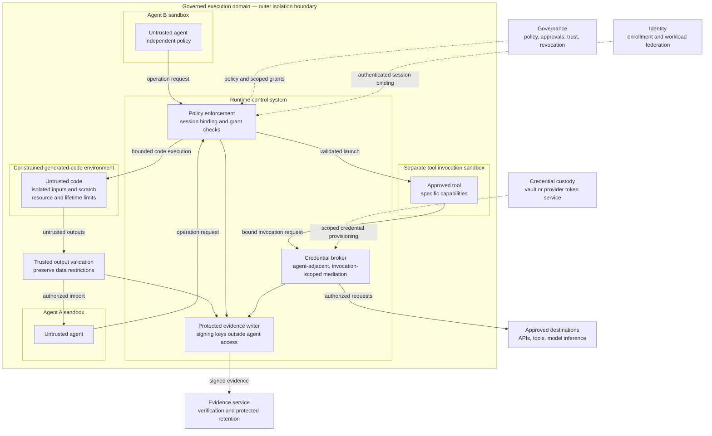
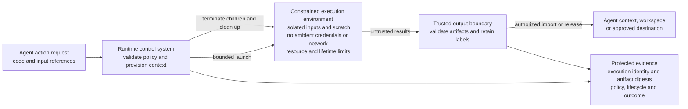
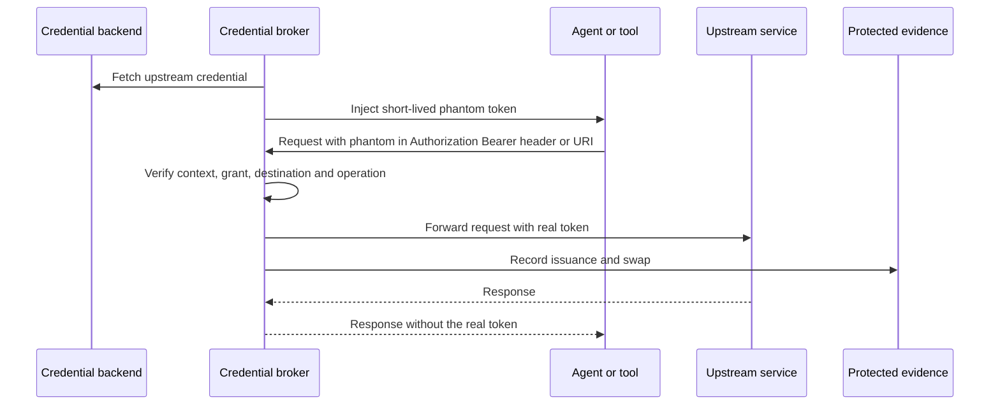
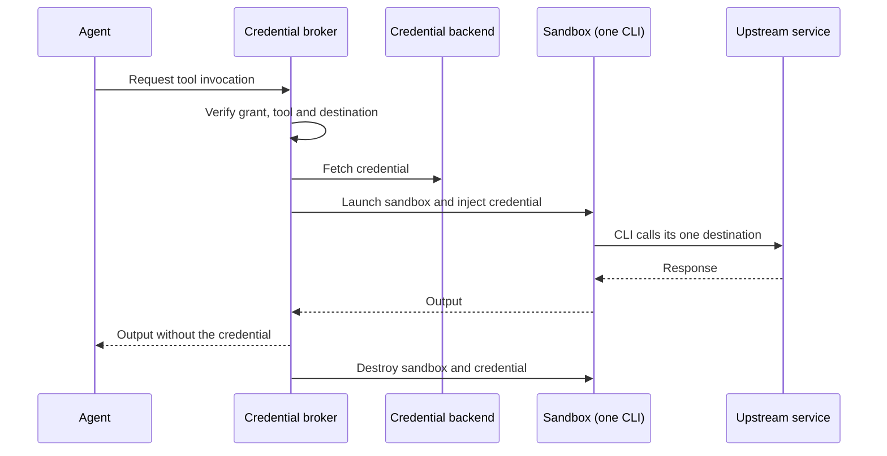
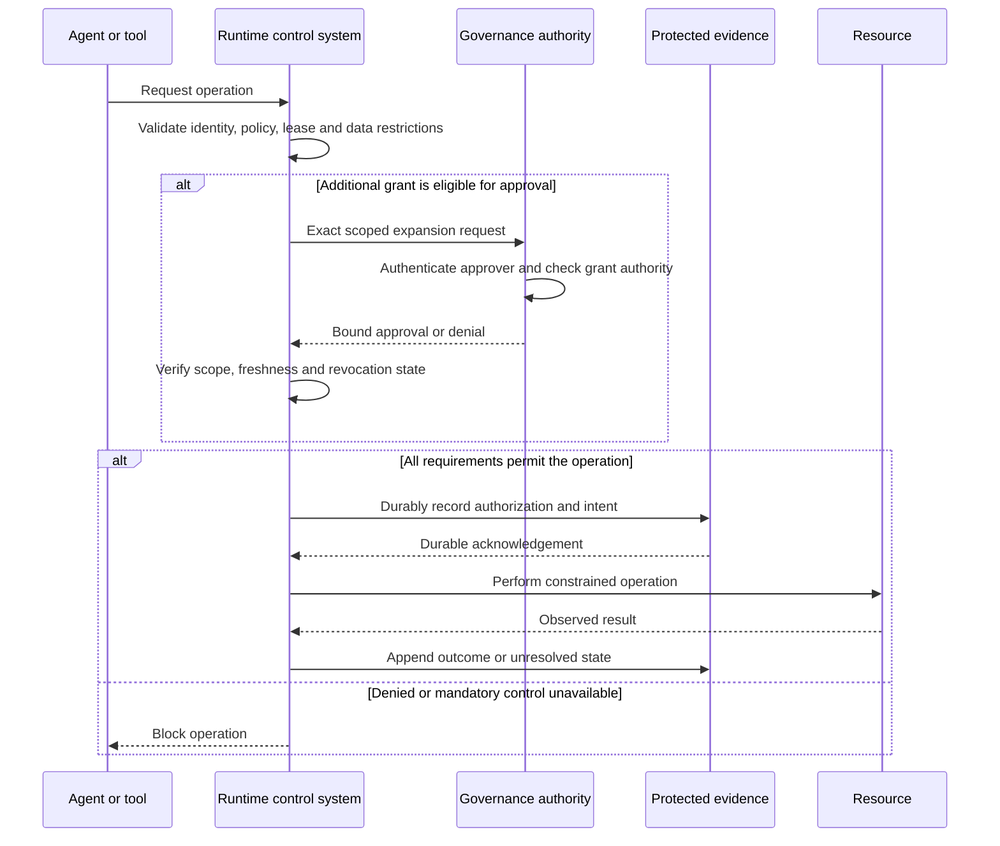
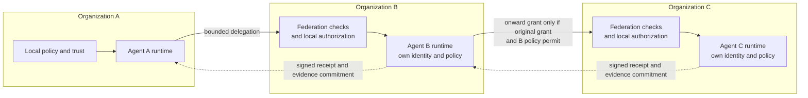
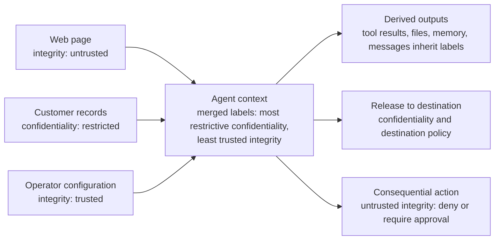
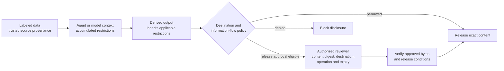

# Agent Runtime Security: A Reference Architecture

**Technical paper · Review draft 0.3 · 14 October 2026**

**Luke Hinds · nolabs, Inc**

**Affiliation disclosure:** The author is affiliated with nolabs. The architecture specifies vendor-neutral security contracts. Draft preparation and research were assisted by OpenAI Codex. This review draft has not undergone independent technical review.

## Abstract

Agent runtime security comprises the mechanisms that translate authority, derived from identity and expressed through policy, into enforceable constraints on the actions agents take and the resources they access. These mechanisms also govern how that authority expands, contracts, or is revoked during execution. Throughout the agent lifecycle, they preserve attributable evidence. Governance spans four concerns: isolation, authorization, information-flow control, and evidence integrity. Each imposes distinct requirements, and all must be satisfied jointly.

This paper presents a reference architecture organized around explicit protection domains and mediated interactions. A control plane, isolated from the agent runtime, enforces narrowly scoped capabilities, brokers credential use, authorizes runtime grant changes that expand or contract authority, and records observations beyond the agent’s reach. Provenance establishes where artifacts came from and whether they were altered, supporting admission decisions. Data labels and taint tracking keep restrictions attached to information as it moves between components.

The architecture’s requirements are independent of where agents run: local machines, continuous integration pipelines, cloud compute, edge devices, or serverless platforms. The paper specifies an architectural model; empirical validation and quantitative performance evaluation remain future work.

## Threat model

Agent behavior is shaped by inputs that may be untrusted or unpredictable, such as content retrieved from web pages, documents, email, and code repositories, or messages from other agents. The agent cannot always reliably distinguish such content from legitimate instructions, because the transformer architecture underlying it does not separate the two: everything shares a single token stream, so any content in context, whatever its source or medium, can act as an instruction. A prompt injection can therefore steer an agent into malicious or destructive actions, carried out with whatever access the agent holds in its execution domain. Training-based defenses reduce this risk but do not establish an enforcement boundary. For this reason, authorization granted at admission is not sufficient on its own; it must remain enforceable at every subsequent action.

### Prompt injection

This reference architecture does not include controls intended to block, detect, or filter prompt injection. As long as instructions and data share a single token stream, we do not expect prompt injection ever to be fully solved, and a design that depends on solving it fails whenever that defense fails. The architecture instead assumes that an injection will sometimes succeed and limits the blast radius: what a compromised agent can reach, change, or disclose, and for how long.

In classic injection attacks, such as SQL injection or shell injection, defense is structural: a parameterized query separates code from data, and the interpreter enforces the separation. A language model has no equivalent. Delimiters, prompt hardening, and training that prioritizes some instructions over others change how likely the model is to follow an injected instruction, but they offer no guarantee that it will not.

The gap becomes clear under adaptive attack. Nasr et al. [[6]](https://arxiv.org/abs/2510.09023) evaluated twelve recent defenses against jailbreaks and prompt injection using attackers who tailor their strategy to each defense’s design. Most defenses that had originally reported near-zero attack success rates were bypassed more than 90% of the time.

### Threat classes

| Threat | Primary controls | Covered in | Residual risk |
| --- | --- | --- | --- |
| Prompt injection | Constrain what any context can do; taint-gated actions | Labels and taint; Constrained execution | The injection itself is not prevented |
| Malicious or destructive actions, code execution | Per-invocation capability contexts; constrained generated-code execution | Constrained execution; Outer isolation boundary | Isolation mechanism flaws |
| Credential theft and misuse | Credential broker; no raw secrets in the agent runtime | Credential broker | Compromised broker |
| Exfiltration and unauthorized disclosure | Data labels, taint tracking, release checks, egress mediation | Labels and taint | Covert channels |
| Memory and persistent state poisoning | Taint on persistent state | Labels and taint | Coarse tracking granularity |
| Propagation between agents | Independent policy per agent; no inherited expansion | Grant changes; Federated authority | Shared writable state |
| Escalation through grants | Approval ceilings; bounded expansion; contraction and revocation | Grant changes; Sessions and freshness | Approver compromise |
| Resource exhaustion | Interference bounds, budgets, leases | Outer isolation boundary; Sessions and freshness | Execution duration is not capped |
| Supply chain | Artifact admission, provenance, signatures | Artifact admission | Verified provenance does not establish that an artifact is safe |
| Isolation escape, control-system compromise | Layered boundaries; protected control system | Outer isolation boundary; Model and terminology | Platform and kernel vulnerabilities |
| Evidence tampering | Protected evidence writer, signed records, external retention | Evidence integrity | Malicious infrastructure operator |

### What the reference architecture does not claim

Along with prompt injections, we do not cover the model training pipeline and supply chain or the inference stack and its ability protect against covert channels, or defend against a malicious infrastructure operator.

## Architectural model and terminology

### Terms

Four primitives recur throughout the architecture. An **action** is an operation initiated by an agent that accesses or modifies a resource, executes code, or discloses or relays information. **Authority** is the bounds on what an agent is permitted to do and to which resources. **Isolation** is the enforced separation of execution contexts. **Evidence** is the recorded observation of what an agent did.

The **agent runtime** is the environment in which agents, tools, and generated code execute; it is untrusted. Each agent, tool invocation, and generated-code execution runs in its own **execution context**, the state and capability scope under which it acts, and the contexts together form a **governed execution domain** within a declared outer isolation boundary.

The **runtime control system** comprises the components outside that environment that hold authority and enforce controls: policy enforcement, credential brokering, and evidence recording. One component or several may implement these functions, provided the agent runtime cannot reach or alter them.

Authority derives from an agent's **identity**, the verifiable name of the principal it acts for, and from any delegation. It is expressed through **policy**, the explicit statement of what authority is granted, to whom, and under what conditions, and is made explicit as grants. A **grant** is a discrete unit of authority: permission for a subject to perform an operation on a resource for a limited time. The action is the unit of authorization: the runtime control system validates the applicable grants and policy, constrains the operation, and records the observations required by the evidence contract. Tool invocations and generated-code executions are specific action classes.

Three further properties are independent of one another. **Authentication** establishes principal identity; **authorization** checks each action against the agent's authority; **evidence integrity** supports verification and proof of recorded observations.

Within this reference model, “must” denotes an architectural requirement and “may” denotes an option permitted under the applicable policy. These terms specify the proposed contracts; they do not imply that an existing implementation has been evaluated against them.

### Trust assumptions

The trusted computing base comprises the runtime control system, the underlying isolation mechanisms and their supporting platform, and the identity and governance services. The baseline model assumes correct operation of the trusted computing base. A malicious infrastructure operator is outside this model; including that adversary requires additional mechanisms and assumptions, potentially including independent evidence witnesses and attested execution environments. Artifact approval and signature verification establish only the properties covered by their verification procedures.

An execution domain may contain several independently governed agents. Each agent and action context retains its own policy and credential scope. Components shared by those contexts create shared trust dependencies; the architecture must identify which failures could affect multiple contexts. Shared writable files are explicit information channels and require policy and provenance handling. Workloads whose required separation cannot be established within one domain need distinct isolation domains.

The protection of the runtime control system must be demonstrated, not assumed. The architecture requires protection of its memory, keys, configuration, control interfaces, and evidence; a process relationship or placement label is not sufficient evidence of that protection. Its placement relative to the outer boundary depends on the isolation design.

## Runtime governance topology



**Figure 3.**


### Boundary roles

The architecture uses two kinds of boundary, which differ in what they separate, not in how they are implemented.

The **outer isolation boundary** separates a governed execution domain from surrounding infrastructure and from other domains. It defines what the domain may be affected by, what failures it must contain, and which interactions may cross it.

**Inner boundaries** separate the contexts inside one domain: each agent, each tool invocation, and each generated-code execution. They define what each context may do with the resources, credentials, and communication paths that the domain makes available.

| | Outer isolation boundary | Inner boundaries |
| --- | --- | --- |
| Separates | A domain from infrastructure and other domains | Contexts within a domain |
| Question answered | What may cross, and what must a failure not escape? | What may this context do? |
| Authority expressed as | Permitted crossings: ingress, egress, shared storage, control messages | Scoped capability and credential-use authority, per agent, invocation, and execution |
| Limits | Interference, resources, and side channels between domains | Reach of a compromised or mistaken agent inside the domain |
| Configured by | The boundary specification; workloads cannot modify it | The runtime control system; submitted code cannot modify its own policy |
| If it fails | Impact beyond the domain | Impact on other contexts, still bounded by the outer boundary |

The two compose. A crossing the outer boundary permits does not authorize every context to use it, and an inner grant cannot bypass an outer restriction.

## Outer isolation boundary

The outer boundary contains an execution domain and defines its relationship to surrounding infrastructure and other domains. Its scope follows the required separation: ownership of data, administrative control, tolerated compromise, and permitted collaboration. An agent, a group of collaborating agents, or a constrained computation may occupy a domain; none of these implies a particular deployment unit.

The boundary specification comprises five elements:

1. **Protected assets:** execution state, data, credentials, control interfaces, and infrastructure whose access or modification is restricted across the boundary.
2. **Permitted interactions:** data ingress, artifact import, network and socket access, shared storage, control messages, and output release, each associated with an enforcement point and explicit policy.
3. **Compromise containment:** the application, runtime, kernel, or other component failures that the boundary is intended to contain, together with the trusted components whose compromise invalidates that guarantee.
4. **Interference bounds:** resource limits and isolation properties for execution, storage, and communication, including explicit side-channel exclusions.
5. **Lifecycle controls:** admission checks, configuration authority, teardown, state reuse, and failure behavior. Workloads must not be able to modify their own protection configuration.

Isolation mechanisms are selected against this specification. Process and operating-system sandboxes, container isolation, language or WebAssembly runtimes, virtual machines, microVMs, and dedicated hosts may contribute different properties in a composed design. These mechanisms have different trust dependencies and enforcement coverage. Selection is subject to the boundary specification rather than a prescribed stack. The implementation must demonstrate the required separation and identify its residual shared dependencies.

Inner boundaries assign narrower authority to the agents and action contexts within a domain; see Boundary roles in the runtime governance topology.

## Explicit policy and least privilege

Authorization decisions must be derived deterministically from explicit policy and authenticated context. Policies refer to concrete resources and operations: executable identity, filesystem paths and access modes, sockets, credential references, destination identities, HTTP methods and paths, validity intervals, and optional consumption limits. Human-readable labels may organize rules but must not replace them with inferred intent.

Effective authority is the intersection of applicable organizational policy, session grants, invocation policy, destination policy, and information-flow restrictions. Delegation constrains who may obtain authority, while the runtime enforces what an operation may do.

Tool identity must bind to the approved executable and its execution context. Executable identity cannot be established solely from a command name. Implementations must address executable replacement, interpreters, plugins, configuration, inherited file descriptors, environment variables, subprocesses, and time-of-check/time-of-use changes. A tool receives only the filesystem, network, socket, and credential permissions explicitly assigned to its invocation.

Paths require canonicalization and component-aware comparison at the enforcement boundary. Network controls require an explicit policy for name resolution, redirects, alternate transports, and connection reuse. If a required mediation mechanism is unavailable, the operation must be denied. A deployment using a different assurance profile requires explicit authorization and an accurate declaration of its enforcement coverage.

## Constrained execution environments

Agent-generated programs, scripts, queries, and notebooks require an independently authorized execution context. The runtime control system establishes a constrained environment whose permissions are limited to the approved computation and input set. Approval of an interpreter or compiler does not extend to the behavior of submitted code.

This environment is a security primitive within runtime governance. Its boundary must protect the requesting agent, other execution contexts, and the runtime control system from the submitted code. The design first specifies accessible inputs, permitted effects, shared trust dependencies, and termination behavior. An implementation is admitted only when its configured controls establish those properties. Where the generated code must be isolated from compromise of a shared enforcement component, its execution requires a separate protection domain.

The default environment is disposable and receives an explicit input set, an isolated writable scratch area, and a defined output channel. It does not inherit the agent's credentials, home directory, socket access, file descriptors, writable workspace mounts, or network authority. Live workspace access requires grants identifying precise paths and access modes. When concurrent modification is unnecessary, read-only snapshots or copies can bind execution to a fixed input set.

| Control | Execution contract |
| --- | --- |
| Code and runtime | Bind the execution request to the submitted artifact digest, approved interpreter or executable, arguments, and policy revision |
| Filesystem | Mount or copy only approved inputs; separate temporary writes from persistent workspace state |
| Credentials and sockets | Deny ambient access; mediate any explicitly authorized credential use or service socket |
| Network | Deny by default; allow only specifically approved destinations and operations through enforced mediation |
| Resources | Enforce CPU, memory, process-count, storage, output-size, and wall-time limits appropriate to the workload |
| Child execution | Keep subprocesses and spawned work within the execution context and its aggregate limits |
| Evidence | Record artifact and input references, effective policy, lifecycle, decisions, and observed outcome outside the generated code's control |
| Completion | Collect only permitted outputs, terminate remaining execution, revoke temporary grants, and clean up ephemeral state |

The execution boundary also applies to build and dependency-processing stages. Package installation, compiler extensions, build hooks, tests, and downloaded dependencies can execute code before the main program starts. Dependency acquisition requires its own constrained access path and provenance policy. Preparation stages are subject to the same explicit authorization requirements as the requested computation.

The runtime creates an execution identity linked to the requesting agent session and validates the code and input references before launch. Failure to establish the required sandbox configuration must deny execution. Additional access requires an explicit scoped approval through the runtime; submitted code cannot modify its own policy. Expiry, revocation, or mandatory audit failure must stop the relevant activity, including subprocesses. Resource-limit termination is recorded as a distinct outcome rather than being reported as successful completion.

Outputs remain untrusted data and inherit applicable information-flow restrictions. Successful execution does not authorize generated files to replace trusted configuration, enter another agent's executable search path, or be published externally. A trusted output boundary validates selected artifacts and applies destination policy before importing them into the workspace or releasing them. Collection must handle symlinks, path traversal, oversized output, and concurrent modification without reading outside the authorized output set. Content-bound approval applies where release requires declassification.



**Figure 4.** Generated-code execution is a governed action with an independent capability context. The runtime control system observes execution from outside the environment; generated code is not the authoritative source of audit evidence. The output boundary does not certify that a computation is correct or benign.

## Credential broker

The credential broker is the runtime primitive that mediates credential use on behalf of an authorized action context. It operates adjacent to the agent while remaining outside the agent's accessible trust boundary. The broker retains upstream credentials and applies them only to authorized operations. A phantom credential is a local reference resolved by the broker and has no authentication authority at the upstream service. Resolution requires verification of the requesting context and the proposed operation.

The credential broker binds use to the authenticated session, action context, credential reference, destination, operation, and current grant. Tool invocations receive independently scoped credential-use authority. It applies the upstream credential only after authorization. The enforcement boundary must prevent the agent from inspecting credential broker memory, modifying trusted configuration, invoking an unrestricted signing interface, or bypassing mediation.

### HTTP credentials



**Figure 5.** The credential broker issues a short-lived phantom token into the agent's environment, and the agent uses it as an ordinary bearer credential in a header or URI. When the request leaves, the broker verifies the requesting context, grant, destination, and operation, replaces the phantom with the real credential, and forwards the request. The upstream service never receives the phantom, and the agent never receives the real credential.

Credential custody and traffic mediation are separate architectural functions. A central authority may provision scoped credentials to distributed credential brokers while credential-bearing requests are authorized adjacent to the workload. This arrangement requires isolation between credential broker contexts and explicit provisioning and revocation contracts.

For HTTP integrations, destination, method, and URI restrictions constrain credential use. HTTPS filtering requires a trusted termination or protocol-aware mediation point with validated upstream TLS. Method and path restrictions must be interpreted against the service API contract. HTTP method names alone are insufficient to establish the effects of an operation.

Requests to authorized endpoints may disclose information through bodies, paths, or query parameters. Request restrictions complement information-flow policy.

### Protocol adapters

HTTP is one of several protocols through which agents use credentials. Databases, remote shells, message queues, and cloud APIs each carry authentication in their own way: a password in a wire-protocol handshake, a private key used to sign a challenge, or a request signature computed locally. The broker handles these with protocol adapters. An adapter terminates the client side of one protocol on a local endpoint, so the agent's client or driver connects as usual but presents a phantom credential. The adapter verifies the requesting context and then authenticates to the real service with the credential held by the broker, so the real credential never enters the agent runtime.

An adapter enforces policy at the granularity of its protocol, as HTTP restrictions do for method and path. For SQL, that can mean permitting read statements against named schemas and denying schema changes, bulk export, or multiple statements in one request. For SSH, the broker can act as a signing agent that signs only for approved hosts and accounts without disclosing the key. For cloud APIs, it can compute request signatures for approved operations. As with HTTP, restrictions must be interpreted against the protocol's semantics, since the name or class of a statement alone may not establish its effects. Encrypted connections require the adapter to terminate the protocol on both sides, as HTTPS filtering does, with validated upstream authentication. Results returned to the agent carry labels like any other tool result.

```mermaid
sequenceDiagram
  participant C as Client or driver
  participant P as Protocol adapter
  participant K as Credential broker
  participant B as Credential backend
  participant D as Database or service
  participant E as Protected evidence

  K->>B: Fetch credential
  C->>P: Connect with phantom password
  P->>P: Verify context; check each statement against policy
  P->>K: Allowed statement
  K->>D: Authenticated query with real credential
  D-->>K: Result
  K-->>C: Labeled result, no credential
  P->>E: Record statements and denials
```

**Figure 6.** A protocol adapter terminates a non-HTTP protocol, here a database wire protocol, on a local endpoint. The agent's client presents a phantom password. The adapter checks each statement against policy, an upstream session authenticates with the real credential, and results are relayed with labels. The adapter's contract is the same for other protocols: resolve a credential reference, verify the context and operation, apply protocol-level policy, authenticate upstream, and record the outcome.

### Brokered tool execution

Phantom credentials and protocol adapters suit tools whose traffic the broker can mediate. Some tools cannot be mediated this way, for example a command-line client that signs requests locally or speaks a protocol for which no adapter exists. Tools requiring local signing need a compatible brokered signing integration, and raw secret exposure to the agent does not satisfy the preferred broker-only credential contract.

For such a tool, the runtime control system runs it in a dedicated sandbox created for the invocation. The sandbox contains only the named CLI and its approved inputs. A scoped, short-lived credential is provisioned into that sandbox and nowhere else, so it never enters the agent runtime. The agent invokes the tool and receives its output; it does not receive the credential.

The sandbox is constrained like any other execution context. Egress is limited to the tool's destination, and the sandbox and credential are destroyed on exit, whether the invocation succeeds or fails. The CLI is trusted only to hold the credential for one invocation. Its output is untrusted data and carries labels like any other tool result.

This is the exception path. It exposes a credential to a process, so it relies on the sandbox boundary together with narrow scoping, short lifetime, and destination limits to bound that exposure. Where a tool can use a phantom credential, that is preferred.



**Figure 7.** In brokered tool execution, only the named CLI receives the credential, inside a sandbox created for the invocation. The agent receives the tool's output through the runtime control system. The credential does not enter the agent runtime, and it does not outlive the sandbox.

## Runtime grant changes

Runtime grant changes modify the authorization state of an active session without requiring application restart, in two directions. Expansion adds explicitly authorized, bounded permissions; contraction removes or narrows them. In both cases the runtime must preserve its existing isolation boundary. For expansion, it must also make the newly authorized operation available through supported mediation.

Active grants and the authorization ceiling of an approver are distinct policy objects. An agent may request expansion but cannot approve it. Requests outside the approver's authority require a separate policy decision; they cannot be satisfied by relaxing enforcement.



**Figure 8.** Grant expansion modifies the active authorization state while preserving the specified isolation and enforcement requirements. The runtime must validate and activate an approval before the additional authority becomes available. The diagram specifies a target operation contract; each resource adapter must identify where that contract can be enforced.

Grant expansion does not propagate automatically to child agents. Each child retains its assigned policy until a separate authorized change is applied. Revocation invalidates grants derived from the revoked authority. Consequently, expansion and revocation have different propagation semantics.

The implementation must state which grant types can expand at runtime. Support for runtime expansion does not require in-place relaxation of kernel restrictions. Trusted brokering and narrowly scoped resource mediation may provide the authorized access while the original sandbox remains enforced.

**Contraction.** Contraction reduces the authority of an active session by removing a grant, narrowing its scope, shortening its validity, or withholding lease renewal. It is the safe direction of change and needs no approval ceiling: an agent, the runtime, or governance may initiate it, and policy may require it automatically, for example when a task phase ends, when sensitive data enters a context, or when a risk signal is raised. Contraction is monotonic within a session; removed authority returns only through the expansion path with a fresh approval.

Contraction must take effect at the enforcement point before it is acknowledged. Unlike expansion, it can usually be applied in place: operating-system restrictions that can only be tightened and brokered access that can be withdrawn both support it directly. Coverage requirements match those for revocation. Reusable connections, subprocesses, credential handles, and in-flight work must fall within the narrowed scope or be terminated, and grants derived from a narrowed grant, including those delegated to child agents, may not exceed the narrowed bound. Contraction differs from revocation in that the underlying authority remains valid and the session continues with less. Each contraction is recorded as evidence, and a contraction that cannot be enforced must terminate the affected activity rather than leave the broader grant in force.

## Session identity and authorization freshness

A session corresponds to one running application instance under runtime control. It has a unique runtime-assigned identity bound to the actual process instance. A process identifier is retained as execution metadata and is insufficient as a globally unique or durable session identity. Tool invocations and delegated agents have separately tracked identities and relationships.

Identity bootstrap uses enrolled devices or federated workload infrastructure. Human, service, agent, session, invocation, and evidence-signing identities remain distinguishable. The runtime protects signing keys and records both the actor and the authority under which it acted.

Authority is refreshed through short-lived leases whose lifetime cannot exceed the underlying grant. Lease renewal checks current policy and ancestor revocation state. Loss of connectivity permits continued governed activity only until the existing lease expires. Expiry blocks further governed activity; it does not require process restart when runtime control and evidence continuity remain intact.

After reconnection, fresh authorization may allow the same process to resume. A restarted process receives a new session. Loss of runtime control or an unexplained evidence discontinuity requires re-establishment of a trustworthy execution context.

Revocation guarantees must cover reusable connections, subprocesses, credential handles, and ongoing work. Revocation of issuance authority must be accompanied by controls on previously issued credentials where their continued use would exceed the specified revocation bound. Each adapter must define its cutoff behavior and maximum delay. Revocation constrains subsequent activity; reversal of completed effects requires a separate recovery mechanism.

## Federated authority

Federation connects independently governed organizations through explicitly configured trust relationships. The receiving organization validates the foreign issuer and grant, then independently authorizes local access under its own policy. Verification of a foreign signature is a prerequisite for evaluating the delegation, rather than a substitute for local authorization.

Every delegation identifies issuer, recipient, audience, permitted resources and operations, validity, parent authority, and onward-delegation conditions. A child cannot enlarge its parent's authority. Optional budgets use case-specific units; allocated child budgets must not duplicate a parent's available capacity.



**Figure 9.** Federation trust is explicitly scoped and does not propagate transitively by default. Organization C independently authorizes its resources. Ancestor revocation invalidates dependent authority across organizations within the agreed lease and propagation bounds.

Federation agreements define accepted issuers, scopes, label mappings, evidence disclosure, revocation behavior, and budget semantics. Each organization retains detailed records and exchanges signed receipts linking actor, session, delegation, local authorization, outcome, and evidence commitments. A commitment enables later integrity checks of disclosed evidence; it does not independently prove policy compliance.

## Data labeling and taint tracking

Authorization determines access to an operation. Information-flow policy constrains its inputs, derived data, and permitted disclosure destinations. Two mechanisms support it: labels record what a piece of data is and where it came from, and taint tracking carries those labels forward to everything derived from it.

### Data labeling

A label is metadata attached to data, a message, an artifact, or an execution context that records the restrictions applying to it. Two kinds are required:

- **Confidentiality labels** record who may receive the data: its classification, its permitted destinations, and any provider or jurisdiction constraints.
- **Integrity labels** record how far the data can be trusted. They derive from provenance, distinguishing data produced by trusted components from untrusted content such as retrieved pages, external messages, and generated output.

Labels are attached by the runtime control system where data enters the governed execution domain, not by the agent. Agent-generated claims about the sensitivity or trustworthiness of data are not sufficient. An agent cannot lower or remove a label. Removing a confidentiality label requires an authorized declassification decision, and raising the trust of an integrity label requires an authorized endorsement.

When data carrying different labels is combined, the result carries the most restrictive confidentiality label and the least trusted integrity label. Label vocabularies are defined by the deploying organization. Unknown classification mappings across organizations must not silently become unrestricted data.

### Taint tracking

Taint is the propagation of labels. Any output derived from labeled inputs inherits the applicable labels. Restrictions conservatively propagate through tool results, shared storage, agent communication, and model outputs. Once sensitive or untrusted data enters an LLM context, subsequent outputs from that context are treated as potentially carrying its restrictions. The treatment is conservative because a model does not separate instructions from data, so it is not possible to establish which part of its context influenced which output.

The proposed propagation model does not assume precise byte-level tracking through arbitrary computations. When precise lineage is unavailable, the runtime uses a coarser boundary such as a process, context, or workspace. That boundary must include indirect channels through shared writable state. Covert channels and malicious trusted components remain outside the baseline guarantee.

Labels have effect only where they are checked. The runtime control system evaluates them at two kinds of sink. The first is release: the transmission of data to a destination, including a model-serving environment, is a governed disclosure, and policy determines which providers and deployments may receive each classification. The second is consequential action: a tool call, code execution, or credential use initiated from a context that carries an untrusted integrity label may be denied by policy or may require explicit approval.



**Figure 10.** Labels are assigned by the origin of data, not by its content. Labels merge in an agent context by taking the most restrictive confidentiality and the least trusted integrity, and outputs derived from the context inherit them. The runtime control system checks confidentiality before data is released to a destination and integrity before a consequential action.



**Figure 11.** Content-bound approval authorizes a specific release. It does not clear restrictions from the originating context or future outputs. Mutation after approval invalidates the release decision.

## Artifact admission

Admission policy governs which executable tools, runtime artifacts, and dependencies may enter the governed execution domain. Artifact identity and production provenance are distinct evidence requirements: identity establishes which artifact this is, and provenance establishes where it came from and how it was produced.

Verified signed manifests bind artifact digests to an authenticated signer, and production attestations describe declared inputs and transformation steps. Cryptographic verification authenticates a claim and its issuer; it does not establish that an artifact is free of defects or malicious behavior. Runtime constraints therefore apply independently of verification results.

Missing mandatory evidence denies admission unless an authorized, scoped exception is recorded. Sensitive workloads can require stronger verification. Model and serving provenance belong to the inference stack and are outside the scope of this architecture, which does not depend on them: agent behavior is treated as untrusted regardless of the model that produced it.

## Evidence integrity, retention, and attribution

The runtime control system produces evidence outside the agent's accessible boundary. The executing agent identity and the observing control-system identity are distinct. Keys and authoritative records remain inaccessible to the agent and its tools.

An operation record should bind session and invocation identities, the relevant grant and policy version, resource and operation, sequence information, authorization decision, and observed outcome. Evidence references should connect model admission, data restrictions, approvals, and federated delegations where applicable. Secrets and unnecessary sensitive content must not enter the audit stream; protected digests and references can bind evidence without indiscriminate payload capture.

Append-only records, cryptographic integrity, and immutable retention are separate properties. Hash chains and signed checkpoints make alterations detectable. Protected storage prevents agent modification. Independent durable retention with an explicit retention policy addresses deletion and truncation by actors outside the agent sandbox. Sequence continuity, checkpoint acknowledgement, and session termination records expose gaps; a valid signature alone does not prove completeness.

In this model, non-repudiation denotes verifiable attribution under explicit identity, key-custody, observation, and retention assumptions. It does not prove a human intended every action, nor does it establish an external service's actual effect without corresponding evidence.

The proposed transactional recording contract requires durable recording of intent before a governed operation and a separately appended outcome. External effects and local logs cannot generally be committed atomically. Interrupted operations remain unresolved until reconciliation; retries require idempotency support or an explicit duplicate-effect policy. Signed external receipts can strengthen evidence where supported.

If required evidence capture or durable local recording fails, the runtime must prevent further governed actions. An already completed external action cannot be undone merely because outcome recording failed. Protected local buffering permits bounded remote delivery outages; exhausted capacity blocks progress. Authorization lease expiry independently blocks activity even when audit storage remains available.

Completeness claims must specify the observed event classes, enforcement points, and excluded channels. Evidence integrity does not establish coverage of actions that bypass observation. A claim of complete observation therefore requires demonstrating mediation of every channel within the declared scope.

## Deployment and failure contracts

| Environment | Runtime governance | Additional boundary |
| --- | --- | --- |
| Developer device | Local control system, invocation policy, local mediation and protected evidence | Device OS and enrollment assurance |
| CI runner | Job-bound sessions, scoped credentials and artifact admission | Runner isolation and CI workload identity |
| Managed workspace | Multiple independently governed agents and action contexts | Declared separation from other workspaces and surrounding infrastructure |
| Independent execution domains | Same per-agent and per-action controls | Independent protection boundaries where shared trust dependencies are unacceptable |

Organization-operated deployments, hosted governance with organization-run execution, and fully hosted execution share the same contracts. The operator of each trust boundary must be explicit. Hosted governance does not require hosted custody of upstream secrets.

| Failure | Required behavior |
| --- | --- |
| Invalid policy, identity, signature or mandatory provenance | Deny affected admission or operation |
| Authorization lease expiry | Block further governed activity pending fresh authorization |
| Parent grant revocation | Invalidate dependent authority within the stated bound |
| Approval unavailable or stale | Do not expand authority |
| Contraction cannot be enforced | Terminate the affected activity |
| Mandatory audit capture unavailable | Block further governed activity |
| Remote evidence delivery unavailable | Continue only within local evidence capacity and authorization lifetime |
| Unknown data classification or foreign label mapping | Block release requiring that mapping |
| Uncertain external operation outcome | Preserve unresolved state and reconcile before unsafe retry |

The failure contracts apply to existing handles and ongoing operations as well as new requests. If an integration cannot satisfy a required bound, policy must deny that use or explicitly select a different, accurately described assurance profile.

## Related work and contribution

**Protection principles and capabilities.** Saltzer and Schroeder describe least privilege, fail-safe defaults, complete mediation, and small protection mechanisms. Their treatment of capabilities and protected subsystems provides a basis for restricted action authority and protected brokering. The present architecture applies those principles to agent execution contexts. The runtime control system has the role of a reference monitor: protected from the subject it governs and positioned to mediate the accesses for which it claims coverage. [The Protection of Information in Computer Systems](https://web.mit.edu/Saltzer/www/publications/protection/Basic.html)

**Workload identity.** SPIFFE specifies identities and short-lived identity documents for software systems across heterogeneous environments. It is a candidate foundation for authenticating runtime components and workloads. This architecture additionally requires binding those identities to sessions, invocation authority, and evidence. Authentication does not itself specify which operation a workload may perform. [SPIFFE overview](https://spiffe.io/docs/latest/spiffe-about/overview/)

**Information-flow control.** Myers and Liskov's decentralized information-flow model distinguishes access from subsequent propagation and supports controlled declassification. The distinction motivates the data restrictions and release approvals proposed here. The conservative treatment of LLM contexts proposed here is an architectural adaptation; it does not inherit the guarantees of a statically checked language or establish precise tracking through arbitrary model computation. [A Model for Decentralized Information Flow Control](https://www.cs.cornell.edu/andru/papers/iflow-sosp97/node1.html)

**Artifact provenance.** Software supply chain frameworks define provenance that connects artifacts to their production origins, and attestation formats provide a structure for verifiable statements about software production. These mechanisms support artifact admission, while policy still decides which signers and claims are sufficient.

**Verifiable logs.** Certificate Transparency specifies Merkle inclusion and consistency proofs for append-only certificate logs. These illustrate how a verifier can check inclusion and consistency relative to authenticated log states. Agent evidence additionally requires a specification of observation coverage, omissions, and operation outcomes. The relevant contribution is the verification mechanism; public certificate-log deployment is not part of this architecture. [RFC 9162](https://www.rfc-editor.org/rfc/rfc9162.html)

The proposed contribution is the composition of these mechanisms within a runtime governance model: action-specific capability boundaries; constrained generated-code execution; adjacent credential brokers; authorized grant expansion without automatic child expansion; conservative information-flow restrictions; and evidence availability as a condition of continued governed activity. The architectural contracts specify interfaces, failure behavior, and observation limits. Conformance requires implementation-specific verification of these contracts.

## Implementation contracts

An implementation can combine multiple mechanisms while preserving the same externally verifiable contracts. Component selection should follow the required trust boundary, platform capabilities, and enforcement coverage.

| Primitive | Required contract | Evidence for review |
| --- | --- | --- |
| Agent runtime security | Mediate protected resources outside agent control | Platform-specific threat model and bypass tests |
| Invocation isolation | Give each tool invocation only its explicit capabilities | Executable binding, environment and subprocess tests |
| Generated-code execution | Run submitted code in a separately constrained context with controlled inputs, outputs and lifetime | Sandbox setup failure, dependency execution, resource exhaustion, output collection and cleanup tests |
| Credential broker | Bind credential use to invocation and operation without exposing upstream secrets | Credential theft, replay and direct-egress tests |
| Runtime grant expansion | Apply approved scope without relaxing unrelated restrictions | Supported grant types, approval binding and negative tests |
| Runtime grant contraction | Narrow active authority in place, covering open handles and derived grants | Enforcement tests and contraction records |
| Evidence production | Protect records and keys; block activity on mandatory capture failure | Coverage statement, integrity verification and storage-failure tests |
| Governance | Authenticate policy changes, approvals and revocation | Durable decision records and authorization tests |
| Outer isolation | Establish declared separation between execution domains and surrounding systems | Boundary coverage, shared dependencies and platform assurance |
| Artifact admission | Verify required provenance against organizational trust policy | Artifact digests, verified claims and admission decisions |
| Workload identity | Bind authenticated workloads to sessions and operations | Issuer trust, key custody, rotation and replay handling |

AAuth addresses cryptographic agent identity, signed requests, and authorization across trust domains. Its specifications remain draft work, with supervision under development. Applicability to this architecture depends on evaluation of its identity, authorization, runtime key-custody, and revocation contracts. [AAuth](https://github.com/dickhardt/AAuth)

Federated cascading revocation, conservative information-flow enforcement, mandatory fail-closed evidence recording, deployment attestation, and shared budget accounting require independent validation. A component's support for one mechanism does not establish conformance to the full architecture.

## Validation and remaining specification work

A conforming implementation must demonstrate isolation and enforcement on each supported operating system and deployment profile. Validation should attempt credential theft and reuse, tool substitution, direct egress bypass, stale approvals, concurrent budget consumption, foreign-issuer confusion, ancestor revocation during disconnection, evidence exhaustion, process restart, and release of modified content after approval.

Protocol specifications must still define canonical grant and evidence encodings, replay defenses, lease and revocation timing, identity-key rotation, label vocabularies, exact admission requirements, and per-resource cancellation semantics. These protocol definitions must permit conformance testing independently of implementation vendor.

Transactional intent/outcome recording is a proposed contract in this draft. Resource adapters must establish where pre-operation durability is achievable and how uncertain outcomes are reconciled. Isolation and runtime overhead, evidence throughput, and revocation bounds require measurement before quantitative claims.

Evaluation must also measure the operational cost of these contracts: tool-launch overhead, credential broker latency, evidence throughput and durability latency, approval latency, revocation propagation, and behavior under partitions and storage exhaustion. Measurements should identify hardware, kernel, workload, policy, concurrency, and the enforced observation scope. Performance comparisons must hold security guarantees constant.

Low enforcement overhead is a design objective. Validated policy may be evaluated locally without a synchronous control-plane request for each operation. Authorization leases, approval requirements, and evidence-buffer limits determine when external coordination is required. Performance claims require measurement under the specified enforcement configuration.

## References

The references identify foundational research, specifications, and implementation work relevant to the architecture. Project documentation and draft protocols are version-dependent; implementation-specific evaluations require fixed source revisions.

1. Jerome H. Saltzer and Michael D. Schroeder. *The Protection of Information in Computer Systems*. 1975. [Paper](https://web.mit.edu/Saltzer/www/publications/protection/).
2. SPIFFE contributors. *SPIFFE Overview*. [Specification overview](https://spiffe.io/docs/latest/spiffe-about/overview/).
3. Andrew C. Myers and Barbara Liskov. *A Model for Decentralized Information Flow Control*. 1997. [Introduction and paper navigation](https://www.cs.cornell.edu/andru/papers/iflow-sosp97/node1.html).
4. B. Laurie, E. Messeri, and R. Stradling. *Certificate Transparency Version 2.0*. RFC 9162, 2021. [RFC](https://www.rfc-editor.org/rfc/rfc9162.html).
5. Dick Hardt and contributors. *AAuth*. Evolving draft protocol work. [Specifications and explainer](https://github.com/dickhardt/AAuth).
6. Milad Nasr, Nicholas Carlini, Chawin Sitawarin, et al. *The Attacker Moves Second: Stronger Adaptive Attacks Bypass Defenses Against LLM Jailbreaks and Prompt Injections*. arXiv:2510.09023, 2025. [arXiv](https://arxiv.org/abs/2510.09023).
